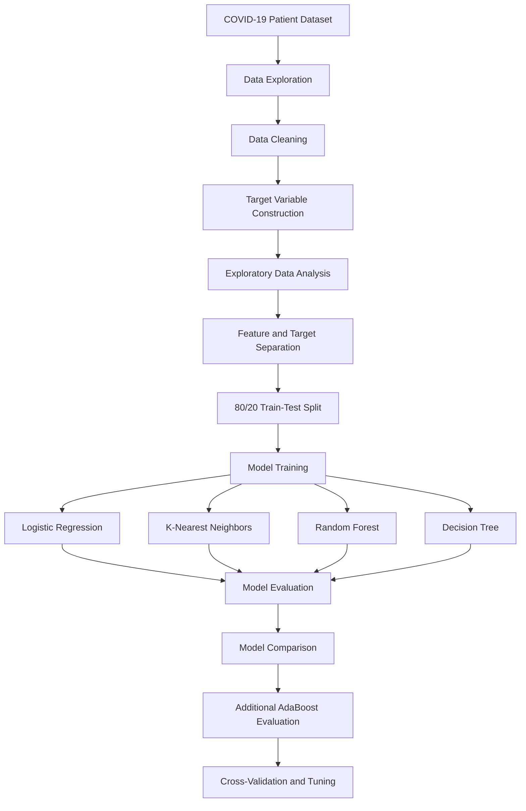
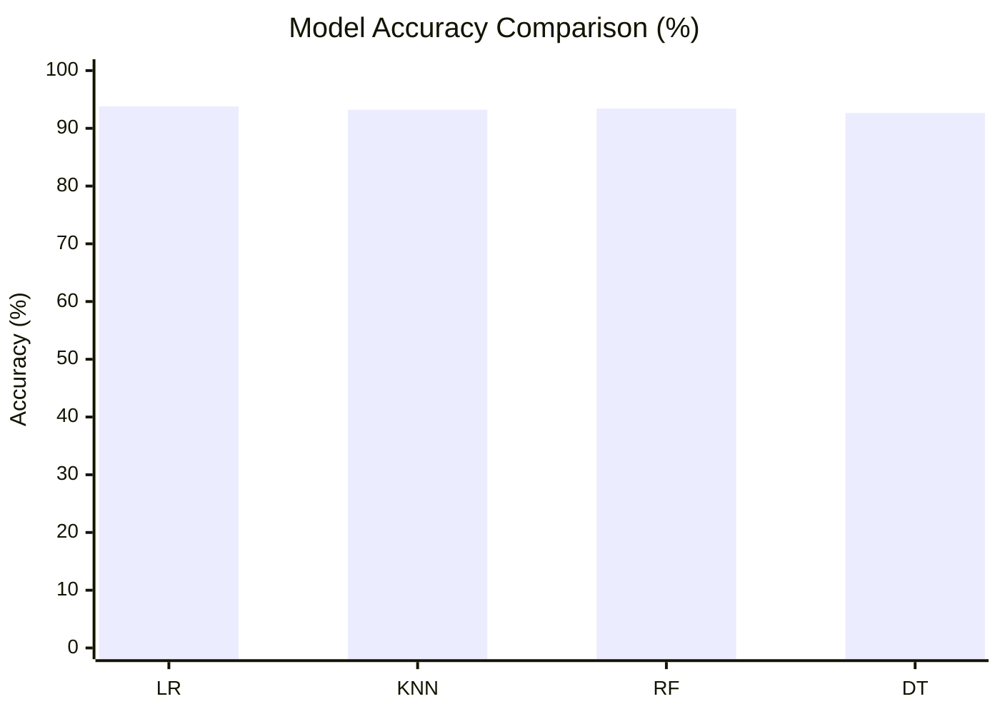

<div align="center">

<picture>
  <source
    media="(prefers-color-scheme: dark)"
    srcset="https://readme-typing-svg.demolab.com?font=Fira+Code&weight=700&size=24&duration=3000&pause=1000&color=36BCF7&center=true&vCenter=true&width=950&lines=Behavior-Based+Grade+Prediction;COVID-19+Patient+Mortality+Prediction;Machine+Learning+%7C+Clinical+Data+Analysis"
  />
  <source
    media="(prefers-color-scheme: light)"
    srcset="https://readme-typing-svg.demolab.com?font=Fira+Code&weight=700&size=24&duration=3000&pause=1000&color=1764A0&center=true&vCenter=true&width=950&lines=Behavior-Based+Grade+Prediction;COVID-19+Patient+Mortality+Prediction;Machine+Learning+%7C+Clinical+Data+Analysis"
  />
  
</picture>

### 🩺 Behavior-Based Grade Prediction Time Series Neural Network

**COVID-19 Patient Mortality Prediction Using Machine Learning**

*Clinical Data Analysis • Predictive Modelling • Healthcare Analytics*

<br/>


<br/>


</div>

---

## 📖 Project Overview

**Behavior-Based Grade Prediction Time Series Neural Network**
is an academic machine learning project focused on
analyzing COVID-19 patient records and predicting
patient mortality outcomes.

The project investigates relationships between
patient characteristics, pre-existing medical
conditions, and recorded clinical information
to identify patterns associated with mortality.

Using a large COVID-19 patient dataset,
the project combines:

- Exploratory Data Analysis (EDA)
- Data cleaning and preprocessing
- Clinical feature analysis
- Statistical visualization
- Supervised machine learning
- Binary classification
- Model performance comparison
- Cross-validation
- Hyperparameter optimization

The implemented prediction task classifies
patient records into two categories:

- **Deceased**
- **Alive**

The project demonstrates how machine learning
can be applied to retrospective healthcare
data analysis.

> [!IMPORTANT]
> Although the original project title includes
> "Time Series Neural Network," the provided
> notebook implements conventional supervised
> classification algorithms. It does not
> demonstrate a trained time-series neural
> network or longitudinal sequence prediction.
>
> The implemented target is binary mortality
> status rather than a multi-level clinical grade.

---

## 🎯 Project Objectives

The main objectives are to:

- Analyze COVID-19 patient characteristics.
- Explore associations between medical conditions
  and recorded mortality outcomes.
- Identify important clinical features.
- Clean and preprocess patient records.
- Visualize demographic and health-related patterns.
- Implement classification algorithms.
- Compare predictive model performance.
- Evaluate classification accuracy and other metrics.
- Investigate model optimization and validation.

---

## 🗂️ Dataset Information

### COVID-19 Patient Dataset

**Source:** Kaggle

**Dataset:** COVID-19 Dataset

[Access the Original Dataset](https://www.kaggle.com/datasets/meirnizri/covid19-dataset)

| Property | Description |
|:---|:---|
| Domain | Healthcare |
| Dataset | COVID-19 Patient Records |
| Original Records | Approximately 1.05 million |
| Original Features | 21 columns |
| Target Variable | `DEATH` |
| Learning Type | Supervised Learning |
| Prediction Task | Binary Classification |
| Train/Test Split | 80% / 20% |

The dataset contains demographic information,
medical conditions, hospitalization indicators,
and COVID-19-related patient information.

### Dataset Attributes

<details>
<summary><b>📋 View Dataset Features</b></summary>

<br/>

| Feature | Description |
|:---|:---|
| `USMER` | Medical care level indicator |
| `MEDICAL_UNIT` | Medical unit identifier |
| `SEX` | Patient sex |
| `PATIENT_TYPE` | Outpatient or hospitalized patient |
| `DATE_DIED` | Recorded date of death or sentinel value |
| `INTUBED` | Intubation indicator |
| `PNEUMONIA` | Pneumonia indicator |
| `AGE` | Patient age |
| `PREGNANT` | Pregnancy indicator |
| `DIABETES` | Diabetes indicator |
| `COPD` | Chronic obstructive pulmonary disease |
| `ASTHMA` | Asthma indicator |
| `INMSUPR` | Immunosuppression indicator |
| `HIPERTENSION` | Hypertension indicator |
| `OTHER_DISEASE` | Other disease indicator |
| `CARDIOVASCULAR` | Cardiovascular disease indicator |
| `OBESITY` | Obesity indicator |
| `RENAL_CHRONIC` | Chronic renal disease indicator |
| `TOBACCO` | Tobacco-use indicator |
| `CLASIFFICATION_FINAL` | COVID-19 classification indicator |
| `ICU` | Intensive care admission indicator |

</details>

---

## 🎯 Target Variable

The original dataset contains the column:

`DATE_DIED`

The notebook converts this field into
a binary classification target named:

`DEATH`

### Target Encoding

| Encoded Value | Meaning |
|:---:|:---|
| `1` | Deceased |
| `2` | Alive / No recorded death |

The original notebook uses the sentinel
value `9999-99-99` to identify records
without a recorded death date.

```python
df["DEATH"] = [
    2 if date == "9999-99-99" else 1
    for date in df.DATE_DIED
]

df.drop(columns=["DATE_DIED"], inplace=True)
```

> [!NOTE]
> The target represents mortality status as
> recorded in the dataset. It does not measure
> disease severity on a continuous scale or
> predict the timing of death.
>
> A record without a death date is not
> necessarily evidence of long-term survival.

---

## 🔄 Machine Learning Workflow

The project follows a structured
data analysis and classification workflow.



---

## 🔍 Exploratory Data Analysis

Exploratory Data Analysis was performed
to investigate the characteristics of
COVID-19 patients and the distribution
of recorded mortality outcomes.

### Key EDA Components

- Dataset shape and column inspection
- Unique value analysis
- Identification of ambiguous category values
- Clinical feature cleaning
- Mortality distribution visualization
- Age and mortality relationship analysis
- Sex-based mortality comparisons
- Obesity and mortality analysis
- Exploration of other clinical indicators

### Clinical Features Investigated

<details>
<summary><b>🩺 View Clinical Factors</b></summary>

<br/>

The dataset includes several medical
and demographic characteristics:

**Demographic Information**
- Age
- Sex

**Pre-existing Medical Conditions**
- Diabetes
- Obesity
- Hypertension
- Asthma
- COPD
- Cardiovascular disease
- Chronic renal disease
- Immunosuppression

**Healthcare and Treatment Indicators**
- Patient type
- Pneumonia
- ICU admission
- Intubation
- Medical unit

**Additional Information**
- Tobacco use
- Pregnancy
- Other recorded diseases
- COVID-19 classification

These attributes are analyzed as
potentially informative variables
for the classification task.

</details>

---

## 🧹 Data Preprocessing

Data preprocessing was performed
to improve the consistency of
the patient records.

### 1. Data Inspection

The notebook examines dataset dimensions,
column types, and unique values.

### 2. Handling Ambiguous Values

Several medical indicators use
numeric codes to represent conditions,
including special codes for missing
or unspecified information.

The notebook filters selected columns
to retain accepted category values.

### 3. Target Construction

The `DATE_DIED` column is converted
into the `DEATH` classification target.

The original date column is then removed.

### 4. Feature and Target Separation

```python
X = df.drop(columns="DEATH", axis=1)
y = df["DEATH"]
```

### 5. Training and Testing Split

```python
X_train, X_test, y_train, y_test = train_test_split(
    X,
    y,
    test_size=0.2
)
```

The original implementation uses:

- 80% of records for training
- 20% of records for testing

---

## 🧠 Machine Learning Models

The project compares four primary
classification algorithms.

### 1. Logistic Regression

Logistic Regression provides a
statistical classification baseline
for estimating the relationship
between patient features and
mortality outcomes.

**Notebook configuration:**

```python
LogisticRegression(max_iter=1000)
```

### 2. K-Nearest Neighbors

KNN classifies patient records
based on the classes of nearby
observations in feature space.

**Notebook configuration:**

```python
KNeighborsClassifier(n_neighbors=6)
```

### 3. Random Forest Classifier

Random Forest combines multiple
decision trees to produce
classification predictions.

**Notebook configuration:**

```python
RandomForestClassifier()
```

### 4. Decision Tree Classifier

A Decision Tree makes predictions
using feature-based decision rules.

**Notebook configuration:**

```python
DecisionTreeClassifier(max_depth=1)
```

### Additional Model: AdaBoost

The notebook also includes an
AdaBoost classification experiment.

```python
AdaBoostClassifier(
    estimator=DecisionTreeClassifier(max_depth=1),
    n_estimators=100
)
```

This model is evaluated using
ROC-AUC analysis.

---

## 📊 Experimental Results

The following results are recorded
in the original Jupyter notebook.

### Model Accuracy Comparison

| Model | Accuracy |
|:---|---:|
| Logistic Regression | 93.79% |
| K-Nearest Neighbors | 93.21% |
| Random Forest | 93.42% |
| Decision Tree | 92.65% |

### Performance Visualization



### Observations

- Logistic Regression achieved the highest
  recorded accuracy among the four
  primary models.
- Random Forest produced the
  second-highest recorded accuracy.
- KNN achieved a similar overall result.
- The shallow Decision Tree achieved
  the lowest accuracy among these models.

> [!CAUTION]
> These are recorded results from the
> original academic notebook, not
> independently reproduced benchmarks.
>
> High classification accuracy alone
> does not establish reliable mortality
> prediction, particularly when class
> distributions may be imbalanced.

---

## 📈 Model Evaluation

The notebook explores several
classification evaluation techniques.

### Evaluation Metrics

| Metric | Purpose |
|:---|:---|
| Accuracy | Overall proportion of correct predictions |
| Precision | Reliability of predictions for a chosen class |
| Recall | Ability to identify members of a chosen class |
| F1 Score | Balance between precision and recall |
| ROC-AUC | Discrimination across classification thresholds |
| Confusion Matrix | Comparison of actual and predicted classes |

### Cross-Validation

The notebook includes five-fold
cross-validation for additional
model assessment.

One recorded cross-validated
accuracy result is approximately:

**87.63%**

This result belongs to a separate
evaluation step and should not be
interpreted as directly interchangeable
with the initial holdout-test scores.

---

## ⚠️ Technical Limitations

<details>
<summary><b>🔬 View Evaluation and Research Limitations</b></summary>

<br/>

### 1. Retrospective Data

The analysis uses existing patient
records rather than a prospective
clinical study.

### 2. Potential Data Leakage

Some clinical indicators, such as
ICU admission and intubation, may
be recorded after disease progression.

Their availability at the intended
prediction time must be established
before interpreting the model as
an early-risk prediction system.

### 3. Class Imbalance

Overall accuracy may be misleading
when mortality outcomes are unevenly
distributed.

Class-specific recall, precision,
and confusion matrices are important.

### 4. Data Coding

Special numeric codes in the
dataset require careful handling
to distinguish valid categories
from missing or unspecified values.

### 5. Generalization

Performance on one dataset does
not guarantee equivalent performance
across hospitals, populations,
or future patient groups.

### 6. Time-Series Limitation

Although the repository title
references a time-series neural
network, the implemented models
operate on tabular patient records.

The notebook does not establish
a longitudinal sequence model.

### 7. Clinical Interpretation

Model outputs should not be
interpreted as medical diagnoses
or validated clinical risk scores.

</details>

---

## 🛠️ Technology Stack

| Category | Technologies |
|:---|:---|
| Programming | Python |
| Data Analysis | Pandas, NumPy |
| Visualization | Matplotlib, Seaborn |
| Machine Learning | Scikit-learn |
| Classification | Logistic Regression, KNN, Random Forest, Decision Tree |
| Ensemble Learning | AdaBoost |
| Evaluation | ROC-AUC, Accuracy, Precision, Recall, F1 |
| Development | Jupyter Notebook, Google Colab |

---

## 📂 Repository Structure

The repository contains the
original academic notebook and
project documentation.

```text
Behavior-Based-Grade-Prediction-Time-Series-Neural-Network/
│
├── CSE437_Project.ipynb
│
└── README.md
```

### File Descriptions

| File | Description |
|:---|:---|
| `CSE437_Project.ipynb` | Dataset exploration, preprocessing, visualization, model training, evaluation, and validation |
| `README.md` | Project documentation, methodology, results, and limitations |

The original notebook is preserved.

---

## 🚀 Installation and Execution

### Prerequisites

- Python 3
- Jupyter Notebook or Google Colab
- Required Python libraries
- Access to the original COVID-19 dataset

### Step 1: Clone the Repository

```bash
git clone https://github.com/Shafin11/Behavior-Based-Grade-Prediction-Time-Series-Neural-Network.git
```

### Step 2: Navigate to the Directory

```bash
cd Behavior-Based-Grade-Prediction-Time-Series-Neural-Network
```

### Step 3: Install Dependencies

```bash
python -m pip install numpy pandas matplotlib seaborn scikit-learn jupyter
```

### Step 4: Download the Dataset

Download the dataset from:

https://www.kaggle.com/datasets/meirnizri/covid19-dataset

Extract the CSV file to a
location accessible by the notebook.

### Step 5: Configure Dataset Path

The original notebook uses
a Google Colab-specific path:

```python
PATH = "/content/drive/MyDrive/CSE437/covid-dataset.csv"
```

Update this variable to match
the location of your downloaded
dataset before running the notebook.

### Step 6: Launch Jupyter Notebook

```bash
jupyter notebook
```

Open:

`CSE437_Project.ipynb`

Run the cells sequentially.

> [!NOTE]
> The original notebook was developed
> in a Google Colab environment.
> Some paths or library-version-specific
> settings may require adjustment.
> Execution has not been independently
> verified in a fresh environment.

---

## 📚 Academic Background

This project was developed as part
of undergraduate coursework at
**BRAC University**.

**Course:** CSE437

**Original Project Title:**
Behavior-Based Grade Prediction
Time Series Neural Network

**Application Domain:**
COVID-19 Patient Mortality Classification

**Project Type:**
Academic Machine Learning Project

---

## 💡 Learning Outcomes

The project demonstrates practical
experience with:

- Healthcare dataset exploration
- Data cleaning and preprocessing
- Handling coded clinical attributes
- Exploratory Data Analysis
- Data visualization
- Binary classification
- Supervised machine learning
- Ensemble learning
- Model comparison
- Classification metrics
- Cross-validation
- Hyperparameter optimization
- Interpretation of model limitations

---

## 📖 References and Resources

- [COVID-19 Dataset — Kaggle](https://www.kaggle.com/datasets/meirnizri/covid19-dataset)
- [Scikit-learn Documentation](https://scikit-learn.org/stable/)
- [Pandas Documentation](https://pandas.pydata.org/docs/)
- [NumPy Documentation](https://numpy.org/doc/)
- [Matplotlib Documentation](https://matplotlib.org/stable/)
- [Seaborn Documentation](https://seaborn.pydata.org/)
- [Jupyter Documentation](https://docs.jupyter.org/)

---

## ⚕️ Research and Ethical Considerations

This repository is intended for
**educational and research purposes only**.

The models are not clinically validated
and must not be used for patient diagnosis,
treatment decisions, triage, or clinical
risk assessment.

The analysis uses the public dataset
referenced above. Any further use of
patient-related data should follow
applicable privacy and ethical requirements.

---

<div align="center">

### 🩺 Data-Driven Healthcare Analytics

*Exploring Clinical Data Through Machine Learning*

**CSE437 | BRAC University**

<br/>


</div>
